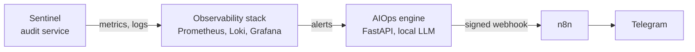

# Ali Fakhrabadi

Senior Python backend, AI automation and DevOps engineer. 10+ years across software
engineering, Linux operations and network security (M.Sc. in IT; LPIC-2, CCNP, CEH,
Security+).

I build Python APIs, self-hosted AI and n8n automation, and the monitoring and
infrastructure code that keeps them running in production.

## Portfolio

Three projects that work together: an audit service, the stack that monitors it, and an
engine that triages the alerts. Every number below was measured, and each README links to
the result files.

| Project | What it is | Measured |
|---|---|---|
| [sentinel-iam-audit-service](https://github.com/ali-fakhrabadi/sentinel-iam-audit-service) | IAM, RBAC and an append-only audit log as a headless API: Django 5.2, DRF, PostgreSQL, Celery, signed webhooks, Helm chart | Ingest p95 33.5 ms at 50 req/s; 1,760 events/s in bulk; 1,200 of 1,200 webhooks delivered |
| [cloud-native-observability-iac](https://github.com/ali-fakhrabadi/cloud-native-observability-iac) | Prometheus, Grafana, Loki and Alertmanager as code, with Ansible roles and Terraform for AWS | 26 unit-tested alerts; a crash loop notified in 58 s; 727 MiB footprint; bare Debian 12 to a running stack in 2 min 42 s |
| [aiops-n8n-incident-engine](https://github.com/ali-fakhrabadi/aiops-n8n-incident-engine) | FastAPI engine that turns alerts into incidents, analyses the logs with a local LLM and notifies through self-hosted n8n | Critical alerts paged in 12.6 s; 5 of 5 causes found and 0 prompt injections followed in the evaluation |

## How I work

* Tests, strict typing and CI on everything, including alert rules, Ansible roles and
  Terraform modules.
* Security by default: non-root containers, secrets from files, signed webhooks, SSRF
  protection, pinned dependencies.
* Claims backed by measurements: load tests and fault-injection drills, with the raw
  results in the repository.

## Stack

**Backend:** Python, Django, DRF, FastAPI, PostgreSQL, Redis, Celery
**AI and automation:** n8n (self-hosted), Ollama, OpenAI API, LLM agents
**DevOps:** Docker, Kubernetes, Helm, Terraform, Ansible, GitHub Actions
**Observability:** Prometheus, Grafana, Loki, Alertmanager
